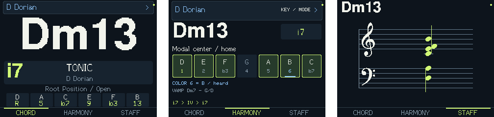

# Chord Display

A little display beside your piano that names the chords you play. Built to help
learn jazz harmony: connect the sound and the shape under your fingers to the
symbol on the page.



*Previews from the same renderer used on the device. The firmware has also been
flashed and tested with a real keyboard and WIDI Master.*

## What it shows

- **Chord:** a large name such as Cmaj7/E, with the notes and their chord degrees.
- **Harmony:** the chord's role in a key or mode you choose, plus a short harmony
  trail for practicing progressions.
- **Staff:** your voicing on a grand staff, with held and pedal-sustained notes
  shown in different colors.

Standard names such as Cmaj7 and Cm7b5 are the default. Alterations sit in smaller
parentheses; optional Jazz symbols are available in Settings. Extended, altered
and rootless voicings are supported. Inferred roots carry a question mark, and an
ALSO line shows useful alternative names.

It reads **MIDI notes** from your instrument. You choose the home key; a single
chord does not determine its musical context.

## What you need

- An **M5Stack Core2** (original ESP32 model, not CoreS3).
- A MIDI keyboard or digital piano with 5-pin MIDI OUT, and a **CME WIDI Master**
  powered by the instrument, for the documented wireless setup.
- A USB-C cable and a computer to install the firmware.

The Core2 receives Bluetooth MIDI as a peripheral in a WIDI group. Once that
group is saved, playing needs no phone or computer.

## Try it

Install [PlatformIO Core](https://docs.platformio.org/en/latest/core/installation/index.html),
connect the Core2 by USB-C, then:

```sh
git clone https://github.com/deoxynet/esp32-chord-display.git
cd esp32-chord-display
pio run -e core2 -t upload
```

Follow the [WIDI setup instructions](docs/user-guide.md#widi-master-setup) to
connect the instrument. Tap A, B or C for Chord, Harmony or Staff; hold C for
Settings. Select your key or mode at the top of Chord or Harmony.

To explore the screens before connecting a keyboard, flash the built-in demo
with `pio run -e core2-demo -t upload`.

## More

- [User guide](docs/user-guide.md): controls, chord symbols, modes, setup and troubleshooting.
- [Tests and screen previews](docs/user-guide.md#test-and-preview-without-hardware): run the analyzer without a device.
- [Recognition and harmony notes](docs/music-theory-audit.md): what the analysis supports and where names remain ambiguous.
- [WIDI setup helper](docs/widi-protocol.md) and [hardware verification](docs/hardware-checks.md).
- [Optional magnetic case](hardware/README.md): printable files; fit and grip still need a first-print check.

## Credits and license

[MIT licensed](LICENSE). Chord recognition is adapted from
[Long Kelvin's MIDI Chord Detector](https://github.com/LongKelvin/midi-chord-detector-plugin),
with [upstream credit and changes](lib/ChordDetector/UPSTREAM.md). Staff glyphs
are derived from Bravura and retain their [SIL Open Font License](lib/ChordApp/NOTATION-LICENSE.txt).
