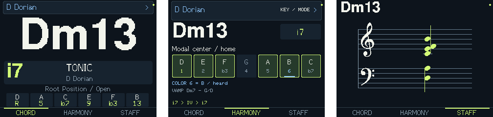
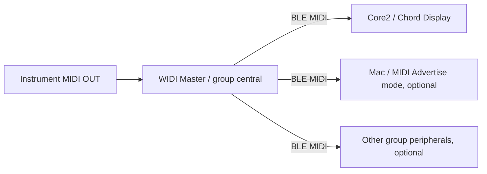

# Chord Display user guide

[Back to the project overview](../README.md). Commands below run from the repository root.

A standalone, chord-first MIDI display for the **M5Stack Core2 (ESP32, 320 × 240)**. MIDI arrives wirelessly from a **CME WIDI Master**. The Core2 advertises as `Chord Display`, a standard BLE MIDI peripheral that a WIDI central can include in a group.



These previews come from the firmware's renderer using the installed device bitmap fonts. The live firmware has been flashed onto a Core2, received MIDI from a WIDI Master acting as the group central, and displayed chord names on the physical screen.

## Display modes

| Mode | What it shows |
| --- | --- |
| **Chord** | Large chord name and slash bass; a separate high-contrast block with a bold Roman numeral, large function label and short detail; inversion/voicing and compact interval chips below. |
| **Harmony** | Selected tonic and mode, chord role, seven scale tones with live highlights, a modal color-tone prompt, practice vamp, and the last four harmonies. |
| **Staff** | Chord name and a large live grand staff, accidentals, ledger lines and octave signs. Held notes are lime; pedal-sustained notes are blue. |

The performance keyboard graphic and separate Analyze tab have been removed. Inversion, voicing and interval information now lives on Chord. A scale-reference keyboard is available in the key picker. Playing screens use a small connection dot and a compact footer, without page titles or a connection banner. Hold C for settings and diagnostics.

The main chord keeps its original font size and position. Functional harmony uses a separate large Roman numeral beside a short label such as **TONIC**, **DOMINANT**, **PRE-DOMINANT** or **BORROWED?**. Target/context detail gets its own line instead of shrinking a long sentence. Interval chips use one compact row, stacking note/degree labels for dense voicings.

**Notation uses a compact grand staff.** Staff lines remain ten pixels apart, with twelve-pixel engraved noteheads, standard clefs, shared chord stems, and collision-aware accidental columns. Adjacent pitches are displaced horizontally; simultaneous natural and altered notes receive explicit signs. Chord details, pitch cards and navigation labels use larger type. This is a pitch/voicing display: it does not transcribe rhythms, score history or key signatures. Large registers get octave signs; pitches that cannot fit are counted as `+N OUTSIDE`. The renderer caps visible heads at 20 and counts any remainder. Chord detection still uses the full input.

Drop 2/3 labels require a four-note voicing that can be reconstructed as a close chord by raising its bass an octave. An asterisk marks inferred drop/rootless labels. The detector's internal match score is a heuristic, not a calibrated probability. Ambiguous sets such as C6/Am7, Cm6/Am7b5 and minor-eleventh/suspended voicings use the bass as a clue; chord identification itself does not infer key or progression context. A recognized pattern must account for every sounding pitch class. Unrecognized sets display `--`.

**Rootless shapes need three distinct pitches and actual guide tones.** A third/seventh plus a supported tone can imply a seventh or extended chord; third/sixth/ninth supports a rootless 6/9. Inferred chord names and Romans carry `?`, and the missing root is never highlighted as played. A compatible reading with its root sounding stays the default.

**ALSO shows useful alternatives** on Chord and Harmony. Close alternatives and readings on the selected tonic/fifth are shown, ordered by the selected key; a rootless primary can show other inferred roots too. This changes the alternative order, without changing the selected key or claiming a unique harmonic intention. The native analyzer and USB `?` diagnostics expose every supported root, with at most eleven alternatives and one spelling per root. A cadence involving an inferred root says `possible` instead of `resolved`.

## Chord symbols

**Standard is the default**, using names such as `Cmaj7`, `Cm7` and `Cdim7`. Hold C or swipe down for Settings → **Chord symbols** to choose **Standard** or **Jazz**. The selection is saved. The optional Jazz formatting applies to chord names in all three views and compact quality signs in Roman numerals; it does not change chord detection or the notes shown on the staff.

| Quality | Jazz | Standard |
| --- | --- | --- |
| Minor | `C-` | `Cm` |
| Minor seventh | `C-7` | `Cm7` |
| Major seventh | `CΔ7` | `Cmaj7` |
| Minor-major seventh | `C-Δ7` | `Cm(maj7)` |
| Augmented | `C+` | `Caug` |
| Diminished | `C°` | `Cdim` |
| Diminished seventh | `C°7` | `Cdim7` |
| Half-diminished seventh | `Cø7` | `Cm7b5` |

The main name stays full size. Alterations appear in smaller raised parentheses, with multiple alterations stacked vertically, as in `Gsus4(b9)` and `C7(b9, b13)`. Slash bass and `6/9` remain inline. Plain text diagnostics retain complete names such as `C7b9b13`. The shared renderer also draws the optional triangle, circle and slashed circle on bitmap displays. These are familiar [lead-sheet chord-symbol conventions](https://handbook.musescore.org/en_gb/text/chord-symbols), with explicit extension numbers retained. [Symbol layout preview](screens/chord-symbols.svg).

**Mu (moo) major chords are supported as `add9`.** C–D–E–G displays as `Cadd9`; the close second/third, spread voicings, octave doubling and an omitted perfect fifth are supported. E–D–G–C displays as `Cadd9/E`. Retaining the major third distinguishes this sound from sus2; adding a seventh changes the chord to 9 or maj9. Becker described the added second and third-in-bass variant in [this interview](https://steelydanreader.com/1990/10/15/metal-leg-14/). There is no separate μ glyph or automatic mu-voicing label. With D in the bass, Cadd9/D also admits D9sus4(no5); the detector favors that bass-rooted reading.

**Cush chords use the existing chord names and modal-interchange readings.** Cush describes mode-mixing progressions rather than a single chord quality. For example, Cmaj7 → Abmaj7 → Bb9 → Cmaj7 retains C as the selected home, with qualified borrowing/backdoor readings. Parallel-major borrowing is supported too. The display does not automatically label a progression “Cush” or infer a new key from it.

## Learn a key or mode

Tap **Key / Mode** across the top of **Harmony**, or the blue key button on **Chord**. The Harmony button uses the entire screen width and a 44-pixel touch region; a longer stationary tap works too. Choose one of twelve tonics and **Major/Ionian, Dorian, Phrygian, Lydian, Mixolydian, Minor/Aeolian, Locrian, or jazz melodic minor**. The first-use reference is **D Dorian**. Your tonic and mode are saved. This is a reference you choose; the device does not guess the key from a single chord.

Mode cards, **Mode +** and horizontal mode swipes use the same **bright → dark** order:

**Lydian → Major/Ionian → Mixolydian → Jazz melodic minor → Dorian → Minor/Aeolian → Phrygian → Locrian.**

The seven diatonic modes follow the [modal-brightness continuum](https://viva.pressbooks.pub/openmusictheory/chapter/intro-to-diatonic-modes-and-the-chromatic-scale/). Jazz minor is placed between Mixolydian and Dorian for comparison: its natural seventh raises Dorian's seventh, while its minor third distinguishes it from Ionian. Mixolydian and jazz minor tie in the sum of their scale degrees; this picker lists the major-third mode first. Swiping left moves darker, right moves brighter, wrapping at the ends. Saved mode IDs remain unchanged when this display order changes.

Swipe **up** from any playing view to open the picker. Its reference keyboard automatically recenters on the selected tonic: **1** stays near the left, **2–7** ascend to the right, and **8** marks the octave tonic. The anchor is the same for white- and black-key tonics; the keyboard keeps its natural white/black geometry. Muted, unlabeled edge fragments provide piano context outside that octave. **Home is green**, **other scale notes are blue**, and the **characteristic tone is amber**. Tap a fully visible white or black on-screen piano key to choose the tonic and recenter the keyboard, or tap a mode below it. Swipe left/right in the picker to compare modes while keeping the same tonic and keyboard position; swipe down or tap Done to return. A steps the tonic, B steps the mode, and C finishes. The same picker is available through Settings → Key / mode. Scale notes follow diatonic spelling, including E# or Cb where appropriate; the existing sharps/flats setting selects enharmonic tonic names.

**The reference reacts to the MIDI keyboard.** Physically held notes turn white; pedal-sustained notes stay shaded blue. Each sounding key shows its degree relative to the selected tonic, including chromatic notes. Thin color strips preserve the reference color; pink strips mark outside tones. Every played octave maps to the same pitch-class key; the tonic's 1 and 8 keys both respond to that pitch class. Muted edge fragments do not repeat highlights or degree labels before 1. Incoming MIDI never changes the selected tonic or moves the reference.

For one sounding note, the line below the piano gives its degree and role: `B = 6 / Dorian color`, `E = 3 / Major third`, or `C# = 7 / Outside Dorian`. Multiple notes get a compact note-to-degree list, with up to six entries and a count for any remainder; every sounding class still lights on the keyboard. These are functions within the selected key/mode, independently of chord recognition. Single notes respond before the chord-settling delay, and note-offs, CC64, MIDI-channel filtering and keys-only sustain settings apply immediately. The existing Hold function freezes this view too.

Try these examples:

| Reference | Play | What Harmony teaches |
| --- | --- | --- |
| **D Dorian** | Dm7, then add B | `i7`, modal center; the natural sixth B is highlighted as the color tone. |
| **D Dorian** | G/D, then Dm7 | IV color above a D pedal; practice keeping D as home. |
| **F Lydian** | Fmaj7, then add B | `Imaj7`; #4/B provides the Lydian color. |
| **C Major** | Dm7 → G7 → Cmaj7 | `ii7 > V7 > Imaj7`; a completed ii–V–I gets a resolution prompt. |
| **C Major** | D7 | `V7/V?`; a possible applied dominant leading to G. |
| **C Major** | Fm7 or Db7 | A possible parallel-minor borrowing or tritone-substitute reading. |
| **C Major** | Cmaj7#11 or G7b9 | Tonic or primary dominant function survives chromatic tensions. |
| **C Minor** | Dm7b5 → G7b9 → Cm6 | Minor-key predominant → dominant → tonic. |

The seven tone cards show **actual played pitches**, not inferred/missing chord tones. Blue underlines identify the mode's focus tone. Notes outside the selected collection are listed in amber as color, with chord-aware spelling such as Ab for G7b9. The practice vamps hold the selected tonic in the bass; they and the major/minor cadence exercises are listening exercises, not prescribed chord scales for every voicing.

Harmony distinguishes tonal and modal readings. G7 in **G Mixolydian** is home; G7 in **D Dorian** is IV color; G7 in **C Major** is V7. **Minor/Aeolian uses composite minor for functional analysis:** natural-, harmonic- and melodic-minor chord qualities can supply tonic, subdominant and dominant functions. Cm6 and Cm(maj7) are tonic; Dm7b5/Dm7 and Fm7/F7 can lead toward G7. The seven reference tones remain literal Aeolian, so raised sixths/sevenths still appear outside that collection. Explicit Dorian and the other modal selections retain their modal readings.

Chromatic hypotheses and inferred rootless Romans carry `?`. Secondary tritone substitutes can target other degrees, such as Ab7 = `subV7/V?` in C, and ascending diminished approaches can suggest a target. Roman numerals summarize triad/seventh quality and suspension type; the full extensions remain in the chord name. Inversions retain the same Roman root and show their position separately.

**Stacks of thirds are tertian harmony:** the familiar triads, sevenths and extended chords. Literal **perfect-fourth stacks are quartal** (`4ths`); **perfect-fifth stacks are quintal** (`5ths`). Both receive a root-ambiguous label and stay out of the functional trail. A quintal voicing can still have a conventional chord name: C–G–D is also Csus2; C–G–D–A–E is also C6/9. The literal-stack label describes the played spacing; it does not claim to reconstruct every inversion or octave redistribution of a stack.

The four-chord trail accepts a harmony after 180 ms, ignores octave/inversion changes that preserve the detected root/quality, and survives ordinary note releases. Hold B to clear both notes and the trail. Changing the tonic/mode, switching demo, or recovering from a lost/corrupt MIDI stream resets it. It is a practice aid, not a rhythm-aware transcription or a key detector; the underlying detector still makes heuristic choices for ambiguous voicings.

The modal design follows the emphasis on characteristic tones and a supported modal tonic in [Ted Pease's Berklee lesson](https://online.berklee.edu/takenote/harmonic-considerations-modal-harmony/), with mode distinctions described in [Paul Schmeling's mode lesson](https://online.berklee.edu/takenote/music-modes-major-and-minor/). Functional families and composite minor follow [Berklee's harmony approach](https://online.berklee.edu/courses/harmony-2). These are local rules, with qualified hypotheses where context is missing. The [music-theory audit](music-theory-audit.md) records the fixes, coverage and remaining limits.

## Lesson archive audit

The [chord analyzer audit](chord-analyzer-audit.md) covers 1,298 distinct
lesson MIDI files and 23 workbook probes. It records three-note rootless gaps,
ambiguous harmonies, and OMR problems separately. Reproduce it locally with
`uv run --python 3.12 tools/audit_lessons.py`; detailed lesson data stays in the
ignored build directory.

## Controls

| Front touch button | Tap | Hold for 650 ms |
| --- | --- | --- |
| **A** | Chord view | Freeze/unfreeze the display (`HOLD`). |
| **B** | Harmony view | Clear live notes and the harmony trail. |
| **C** | Staff view | Open/close settings. |

The three on-screen footer tabs also select modes. In settings, A selects the next row, B changes it and C closes the menu; tapping a row changes that setting directly.

Playing screens stay quiet when no harmony is recognized: the chord placeholder is `--`, with no generic play-a-chord, keep-the-tonic-home or explore-these-notes message. Role labels appear when a chord or a meaningful quartal/quintal interpretation is available.

| Swipe in the screen content | Playing views | Key picker | Settings |
| --- | --- | --- | --- |
| **Left / right** | Next / previous view, wrapping through Chord → Harmony → Staff. | Next / previous musical mode. | No setting changes. |
| **Up** | Open key/mode picker, including from Staff. | — | — |
| **Down** | Open settings. | Close picker. | Close settings. |

Swipes act once on release and require a clear direction. Small movements, ambiguous diagonals and strokes starting on the footer/button strip do not navigate. Both quick flicks and deliberate drags work; taps and A/B/C controls remain available. If the picker was opened from settings, dismissing it returns to settings.

Settings include Omni/channel 1–16, sustain versus keys only, sharp/flat spelling, screen brightness, Bluetooth mode, key/mode, Jazz/Standard chord symbols and a built-in demo progression. These settings and the selected display mode survive a restart. Older saved Analyze selections migrate to Chord. Demo and freeze are temporary. A disconnect, corrupt packet or receive-queue overflow clears live notes and unfreezes the display.

Bluetooth defaults to **WIDI group**: the Core2 advertises as a peripheral and lets the WIDI central initiate the connection. **Auto** also searches for nearby WIDI peripherals after six seconds. **Direct WIDI** uses the Core2 as the central; this is a fallback for a standalone link. Keep **WIDI group** selected when building a WIDI-controlled group.

## WIDI Master setup

Use the **WIDI Master at the playing instrument as the central** and the Core2 as a peripheral:



1. Connect the WIDI Master's main adapter to the instrument's **MIDI OUT**, and confirm the instrument powers it. Enable MIDI note output on the instrument.
2. Select **Bluetooth → WIDI group** on the Core2. This is the firmware default. Its settings and USB serial output show its public BLE address.
3. Close the phone's WIDI app and temporarily turn that phone's Bluetooth off to free the control connection.
4. Use the [command-line setup helper](widi-protocol.md) to save the intended member addresses. It supports up to four peripherals and programs the WIDI entirely in software.
5. The Core2's connection dot should turn green and the display should respond to the keyboard. Check reconnection after restarting the devices. This firmware keeps the Core2's public BLE address stable so the WIDI can remember it.

The helper bypasses the inaccessible phone UI using the app's recovered MIDI SysEx commands. For the attached Core2:

```sh
uv run tools/widi_control.py status
uv run tools/widi_control.py group --peripheral AA:BB:CC:DD:EE:01
```

Use your device's address if building on another Core2. The helper backs up the existing settings, writes the saved group, verifies every register and releases its control connection. Saving these known addresses requires no WIDI hardware control. A saved Core2-only group works without a phone or Mac.

`uv run tools/widi_control.py learn` enables the recovered **Group Auto-learn** discovery state. Use `group` with explicit addresses for the software save procedure. CME's phone app normally discovers third-party peripherals through Auto-learn; its manual group editor lists WIDI products.

**Group routing matters:** CME documents central-to-peripheral communication and no direct communication between peripherals. If the playing instrument's WIDI is another peripheral in an existing group, the display may not receive its notes. Put the source WIDI in the central role, or configure a MIDI router that explicitly sends the source data to the group's central output.

**To receive MIDI on the Mac too:** open Audio MIDI Setup → MIDI Studio → Open Bluetooth Configuration and enable **Advertise**. Include the Mac as another peripheral in the WIDI group. The WIDI Master remains central for both the Mac and Core2. Keep the Mac awake with that window open during enrollment. If macOS keeps restoring an old outgoing WIDI connection, finish programming the group, then forget the old **WIDI Master** pairing in System Settings → Bluetooth while MIDI advertising is active. The WIDI can then initiate a fresh incoming connection. Both links were observed together on the attached setup; see [the protocol notes](widi-protocol.md) for the saved addresses and evidence.

If a phone/computer keeps taking the WIDI connection, disconnect it during setup. CME specifically documents iOS auto-reconnection as a source of group-pairing problems. The Core2 settings show its BLE address; USB serial prints connection/disconnection events. Pair through BLE MIDI/WIDI tools, not the ordinary Bluetooth audio menu.

Sources: [CME group auto-learn instructions](https://www.cme-pro.com/wp-content/uploads/2022/10/WIDI-Master-manual_v08_English.pdf), [CME WIDI App guide](https://www.cme-pro.com/cme-widi-app-online-start-guide/), [CME group routing and setup](https://www.cme-pro.com/widi-master-start-guide-bluetooth-midi/).

## Magnetic display case

The [parametric OpenSCAD case](../hardware/README.md) holds two 10 × 3 mm disk
magnets on the Core2's bottom edge, so the screen can stand upright on a magnetic
keyboard lip. It prints as one piece, flat back down, without supports or screws.
Case fit and magnetic grip still need a first-print check.

## Build and flash

Install [PlatformIO Core](https://docs.platformio.org/en/latest/core/installation/index.html) and connect a Core2 over USB-C. Dependencies and toolchain versions are pinned in `platformio.ini`.

```sh
pio run -e core2
pio run -e core2 -t upload
pio device monitor -b 115200
```

The normal image starts with live BLE input. To boot directly into the demo progression:

```sh
pio run -e core2-demo -t upload
```

The resulting application binaries are `.pio/build/core2/firmware.bin` and `.pio/build/core2-demo/firmware.bin`. These application images go at **0x10000**, not at zero; use PlatformIO upload to install the matching bootloader and partition table automatically. This project targets the original ESP32 **Core2**, not the CoreS3. The USB connection is for programming/logging; MIDI input uses BLE.

## Test and preview without hardware

Portable tests need CMake and a C++17 compiler. The sanitizer option supports Clang/GCC:

```sh
cmake -S . -B build -DCMAKE_BUILD_TYPE=Debug -DCHORD_SANITIZE=ON
cmake --build build -j 4
ctest --test-dir build --output-on-failure
```

The tests exercise chord recognition, transpositions/inversions, octave doubling, independent MIDI channels, pedal/retrigger/controller behavior, BLE framing/running status/SysEx, malformed packets, 20,000 parser fuzz inputs and notation pitch preservation across MIDI's full range. Harmony tests cover all twelve major keys, every selectable mode/transposition, modal versus tonal readings, chromatic hypotheses, fourth stacks, trail/cadence behavior, key-picker touch geometry and the enlarged staff. Live-reference cases cover immediate single-note feedback, polyphony, octave merging, independent held/pedal states, channel filtering, chromatic degrees and enharmonic note spelling in every selectable key/mode. Scrolling geometry tests verify fixed tonic anchors, ascending degrees, complete chromatic coverage, black/white spacing and touch targets in all twelve tonic positions.

Symbol tests cover Jazz/Standard formatting for chord families, extensions, inversions, enharmonic roots and 6/9, plus vector-glyph measurement and rendering at every device font size. Brightness-order tests cover touch/swipe/button consistency and stable saved mode IDs.

Jazz-theory regressions exercise every full chord pattern in all twelve keys, all 4,096 pitch-class subsets for unexplained/missing tones, shells and omitted lower tensions, altered/suspended voicings, mu major, Cush-style interchange, composite minor, secondary dominants/substitutes, diminished approaches, interval stacks and cadence quality. Recognition does not certify every tone as an available improvisational tension; the reference is not a chord-scale or avoid-note recommender.

Candidate tests independently enumerate all eligible roots for each of those 4,096 subsets, verify that none are lost, and check the evidence for every alternative. Rootless/shell voicings also run through all twelve transpositions, octave changes, ordinary triad controls and insufficient-note cases. The [corpus audit and follow-up](chord-analyzer-audit.md) keep coverage, intended harmony, missing evidence and transcription damage separate; there are no lesson-specific firmware rules.

After `pio run -e core2` or `pio pkg install -e core2` installs the display fonts, rerun CMake to enable the native preview target:

```sh
cmake -S . -B build
cmake --build build -j 4
./build/chord_preview docs/screens
# Optional MIDI notes for a different preview; use a separate output directory:
./build/chord_preview build/c7b9 60 64 67 70 73
```

The preview creates SVGs of all three tabs, settings and the key picker from the same renderer used on the device. The checked-in example is Dm13, including Dorian's natural sixth B. `chord-symbols.svg` checks full-size qualities, raised/stacked alterations and inline slash bass. Extra `key-idle.svg`, `key-note.svg` and `key-pedal.svg` previews show a quiet reference, a single color tone, and mixed held/sustained chromatic notes. `key-sharp.svg` and `key-flat.svg` show tonic anchoring in F# Lydian and Bb Dorian. Primitive rasterization may differ slightly from the actual LCD. See [the hardware bring-up checks](hardware-checks.md) for the remaining device validation.

For serial diagnostics, `tools/serial_console.py` accepts a USB port, `--duration`, `--command` and `--log`. Run it with a Python environment containing `pyserial` (PlatformIO's environment already includes it). Commands are `?` for MIDI/harmony status, `s` for a diagnostic scan, `g` for group mode, `a` for auto and `d` for direct. `t` saves Standard symbols; `j` saves Jazz symbols; status reports the saved selection. Uppercase `C`, `H`, `N` select Chord, Harmony and Staff; `K` opens/closes the key picker. `L`, `R`, `U`, `D` exercise the same handlers as left, right, up and down swipes for bench checks. Opening the USB serial port can reset the Core2.

## Algorithm and implementation

The embedded staff glyph subset is generated from Bravura 1.482 and distributed as Chord Staff Glyphs under the [SIL Open Font License](../lib/ChordApp/NOTATION-LICENSE.txt). Only eight small monochrome glyphs are compiled into the firmware; the original font is a build-time input to `tools/generate_notation_glyphs.py`, which verifies its SHA-256 before generation.

The chord detector starts with [Long Kelvin's MIDI Chord Detector](https://github.com/LongKelvin/midi-chord-detector-plugin), pinned to commit [`07bdccc`](https://github.com/LongKelvin/midi-chord-detector-plugin/tree/07bdccc4903968e7b2a13845f6a5cfa3458a768c). Its pattern database is vendored with the original MIT license. The embedded adaptation scores pitch-class masks, materializes at most three full candidates and keeps other supported roots as compact alternatives. [Upstream attribution and changes](../lib/ChordDetector/UPSTREAM.md) describe the differences.

BLE callbacks only parse and queue events. The main task owns note state, chord detection and rendering. A fixed 256-event queue and a connection generation counter discard stale events after reconnects, malformed packets or overload. MIDI clock and active sensing do not occupy that queue. Note bursts settle for 35 ms, with an 85 ms maximum scheduling delay during continuous changes; BLE, computation and LCD transfer add their own latency. Rendering uses a 150 KiB framebuffer in Core2 PSRAM. These are implementation limits, not measured hardware performance claims.

| Path | Purpose |
| --- | --- |
| `src/` | M5Unified canvas, NimBLE peripheral and device controls/persistence. |
| `lib/ChordApp/src/` | Portable MIDI parser/state, analysis, notation layout and display renderer. |
| `lib/ChordDetector/` | Vendored/adapted detector and license. |
| `tests/` | Native regression tests. |
| `tools/preview.cpp` | Native SVG renderer using the device's installed fonts. |

## Source and license

[Chord Display on GitHub](https://github.com/deoxynet/esp32-chord-display) is
released under the [MIT license](../LICENSE). The adapted detector retains
[Long Kelvin's MIT notice](../lib/ChordDetector/LICENSE), and the staff glyphs
retain their [SIL Open Font License](../lib/ChordApp/NOTATION-LICENSE.txt).
No lesson PDFs, recordings or MIDI archives are included.
