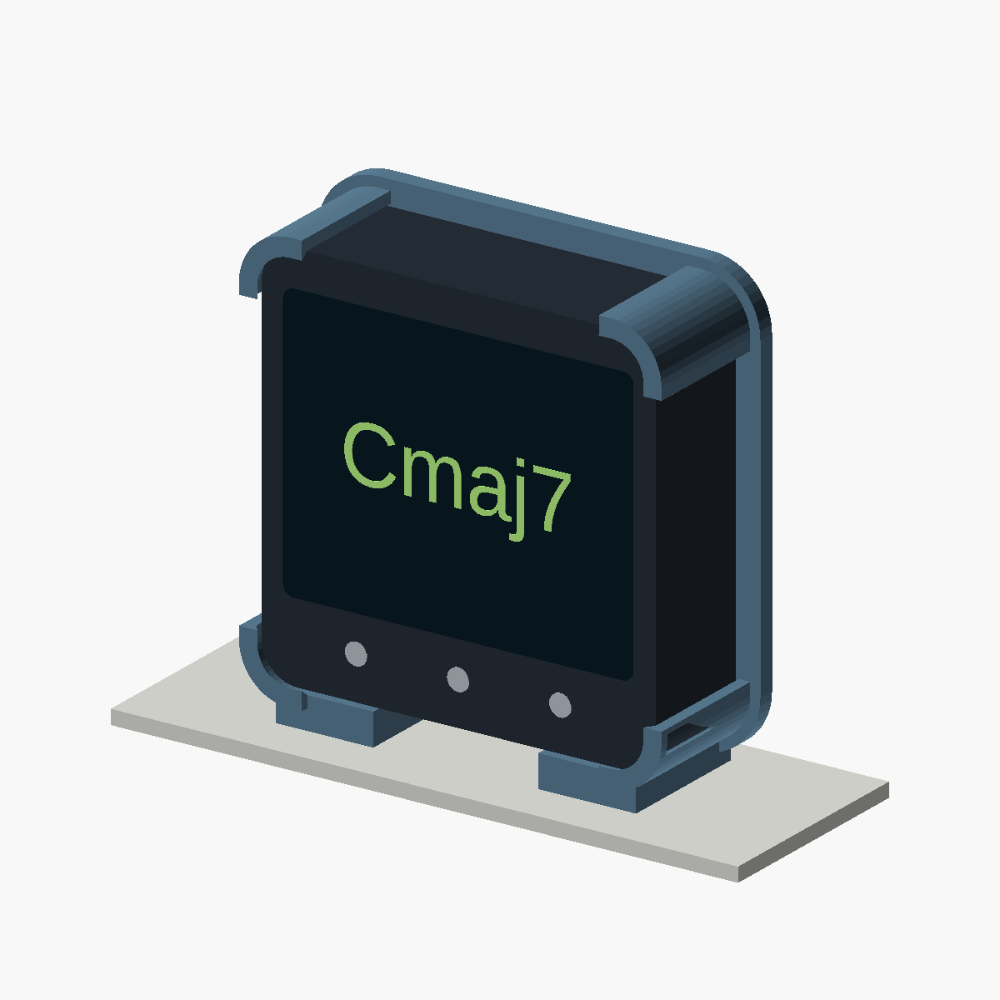

# Core2 case with bottom-edge magnets

[OpenSCAD](core2_magnetic_case.scad) · [STL](stl/core2_magnetic_case.stl) · [installed preview](previews/assembly.png) · [print orientation](previews/print_layout.png)

One printed piece holds the Core2 and **two 10 × 3 mm disk magnets**. The magnets
sit on the **narrow bottom edge**, with their flat faces pointing downward, so
the screen stands upright on the keyboard's front lip.

The magnet pockets are **covered at the front and open underneath**. Sloped
pocket roofs let the case print **flat back down, without supports**. Glue the
magnets in from the underside afterward. No screws or separate printed parts.



Print the supplied STL as oriented, with the flat back on the bed. PETG,
0.2 mm layers and four walls are a starting point for the flexible corner clips.
Glue the magnets into the two pockets from below and let the glue cure before fitting
the Core2. Their faces project approximately **0.2 mm below the plastic** for
direct contact with the keyboard lip. Seat the Core2's lower corners, flex the
upper clips outward, and settle its top corners in place. The USB side remains
open; the centre of the bottom edge is also open between the magnet holders.

Try a loose magnet on the intended lip before printing. The preview's lip is
illustrative; magnetic grip and physical fit have not been tested on the piano.

| Parameter | Default |
| --- | --- |
| `magnet_diameter`, `magnet_thickness` | 10 × 3 mm |
| `magnet_diameter_clearance` | 0.2 mm; pockets are 10.2 mm wide |
| `magnet_proud` | 0.2 mm; seats are 2.8 mm deep |
| `magnet_spacing` | 36 mm centre to centre |
| `core_width`, `core_height`, `core_thickness` | 54 × 54 × 16.5 mm |
| `core_corner_radius` | 5 mm, supplied by owner |
| `device_clearance` | 0.35 mm per side |

The Core2 envelope comes from [M5Stack's dimensions](https://docs.m5stack.com/en/core/Core2).
In OpenSCAD, select `part="installed"` for the upright view or `part="case"`
for printing. Preview magnets, device and keyboard lip are excluded from exports.

```sh
openscad --hardwarnings --backend CGAL --export-format binstl -D 'part="case"' \
  -o hardware/stl/core2_magnetic_case.stl hardware/core2_magnetic_case.scad
```

The exported case is checked for a closed, consistently oriented mesh. Clip
fit, magnet bonding and holding strength still need a first-print check.
